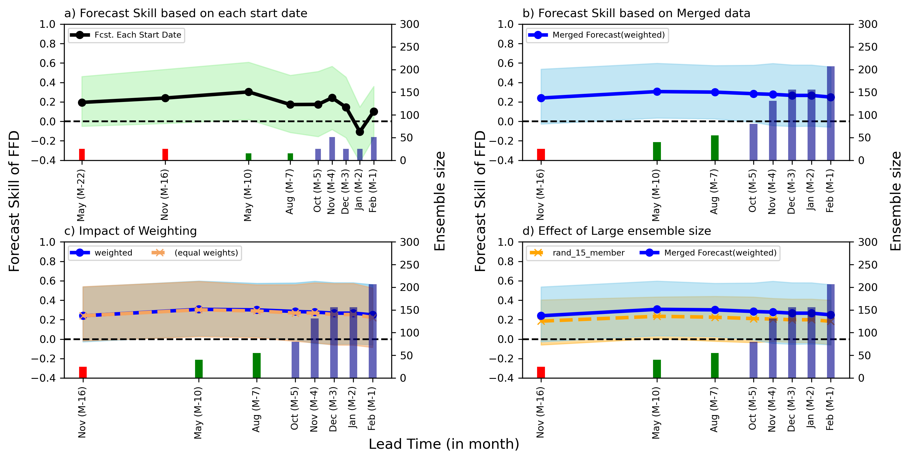
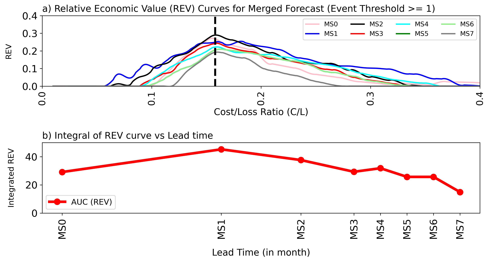
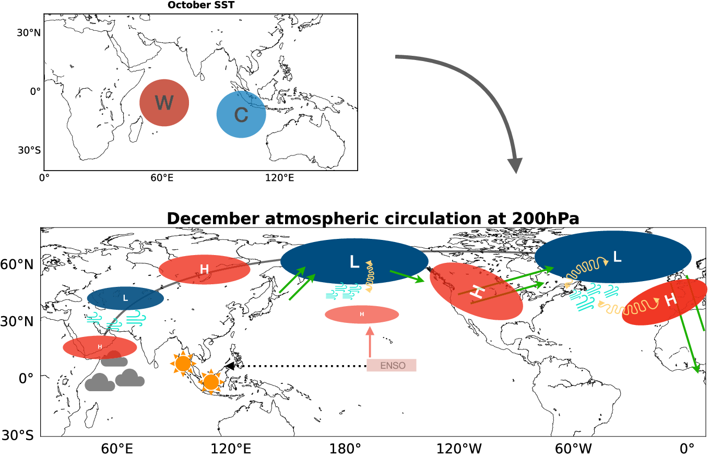

<h2>Tailoring Climate Forecasts to Action</h2>

  

    <!-- First figure -->
    

    

      <em>
        Seamless forecast based on temporal merging.
        (a) Forecast skill (anomaly correlation) of FFD
        (black line, primary y-axis) during spring
        (March–April) for each start date over 1983–2022;
        ensemble size is shown on the secondary y-axis.
        (b) Forecast skill of the temporally merged forecast
        (blue line, primary y-axis) at each merged step,
        with corresponding ensemble size on the secondary
        y-axis. (c) Impact of equal versus relative weighting
        on merged forecast skill. (d) Comparison of forecast
        skill using randomly subsampled 15 ensemble members
        (orange line) with the full merged ensemble
        (blue line). Shading indicates the 5–95% confidence
        interval; values excluding zero indicate statistical
        significance. Note that the x-axis is nonlinear.
      </em>
    

    <!-- Second figure -->
    

    

      <em>
        Relative economic value (REV) of the
        merged forecast: a) REV of the frequency of frost days (FFD) 
        for the merged forecast,vertical dashed line represents 
        climatological observed probability; b) Integrated REV across 
        cost/loss curve of the merged forecast at each merged step
        (MS). The x-axis is non-linear.
      </em>
    

  

  

    

      Climate forecasts are most useful when they can support
      real-world decisions. My research explores how scientists
      and industry can work together to develop climate
      information that meets the needs of decision-makers.
    

    

      In particular, I have developed an approach that combines
      ensemble forecasts across different start dates, linking
      interannual and seasonal predictions into a seamless
      forecasting framework. This approach helps provide more
      consistent climate information across timescales and
      demonstrates its potential value for supporting practical
      decisions and managing climate-related risks.
    

    

      <strong>Related publication:</strong> 
      <a href="https://doi.org/10.1038/s44304-026-00269-6">
        <strong>Abid, M.A.</strong>, Balan Sarojini, B. &amp; Weisheimer, A.
        (2026). Bridging multi-annual to seasonal forecasts to develop
        seamless information for climate extremes: frost risk application.
      </a>
      <em>npj Natural Hazards</em>.
    

  

<h2>Inter-basin: Role of Indian Ocean in ENSO Teleconnections to North Atlantic &amp; Europe</h2>

  

    

    

      <em>
        Indian and Pacific Ocean contributions to the Euro-Atlantic
        circulation response to ENSO and their seasonal evolution
        from early to late winter (Abid et al., 2021).
      </em>
    

    

    

      <em>
        October Indian Ocean Dipole (IOD) teleconnections to
        extratropical atmospheric circulation during early
        boreal winter (Raganato et al., 2025).
      </em>
    

  

  

    

      My research investigates how tropical ocean variability,
      particularly the El Niño–Southern Oscillation (ENSO) and
      Indian Ocean conditions, influences climate variability
      and predictability over the Euro-Atlantic region on
      subseasonal to seasonal timescales.
    

    

      <strong>Related publications:</strong>
    

    

      <a href="https://doi.org/10.1175/JCLI-D-20-0075.1">
        <strong>Abid, M.A.</strong>, Kucharski, F., Molteni, F.,
        Kang, I.-S., Tompkins, A.M. &amp; Almazroui, M. (2021).
        Separating the Indian and Pacific Ocean impacts on the
        Euro-Atlantic response to ENSO and its transition from
        early to late winter.
      </a>
      <em>Journal of Climate</em>.
    

    

      <a href="https://doi.org/10.1175/JCLI-D-23-0703.1">
        Raganato, A., <strong>Abid, M.A.</strong> &amp; Kucharski, F.
        (2025). The combined link of the Indian Ocean Dipole and
        ENSO with the North Atlantic–European circulation during
        early boreal winter in reanalysis and the ECMWF SEAS5 hindcast.
      </a>
      <em>Journal of Climate</em>.
    

  

<h2>Role of Indian Ocean in ENSO Teleconnections to South &amp; West Asia</h2>

  

    

    

      <em>
        (a) Correlations between the standardized CSWA, Niño3.4,
        and TWEIO precipitation indices. (b) Same as (a), but
        using linearly independent Niño3.4 and TWEIO indices.
        (c–h) Regression of precipitation (shading; mm/day) and
        200-hPa geopotential height (Z200) anomalies (contours; m)
        onto the standardized TWEIO precipitation index after
        removing the effect of Niño3.4. (i–n) Same as (c–h),
        but for the standardized Niño3.4 index after removing
        the effect of TWEIO. Purple contours indicate statistical
        significance at the 95% confidence level.
      </em>
    

  

  

    

      My research investigates how the tropical Indian Ocean
      mediates ENSO teleconnections to Southwest Asia.
      I examine the relative contributions of the Indian and
      Pacific Oceans and the physical mechanisms underlying
      their influence on regional precipitation variability
      through observational analyses and modelling experiments.
    

    

      <strong>Related publication:</strong> 
      <a href="https://doi.org/10.1029/2020GL089308">
        <strong>Abid, M.A.</strong>, Ashfaq, M., Kucharski, F.,
        Evans, K.J. &amp; Almazroui, M. (2020).
        Tropical Indian Ocean Mediates ENSO Influence Over
        Central Southwest Asia During the Wet Season.
        <em>Geophysical Research Letters</em>.
      </a>
    

  

<h2>ENSO-Arabian Peninsula Seasonal teleconnection & predcitability</h2>

  

    

    

      <em>
        ENSO to Arabian Peninsula summer rainfall in summer season.
      </em>
    

  

  

    

      Drought conditions are particularly alarming for a 
      water-scarce region like the Arabian Peninsula. 
      El Niño Southern Oscillation (ENSO) strongly influences 
      the southwestern peninsula rainfall and drives drought 
      conditions in its warm phase.
    

    

      <strong>Related publication:</strong> 
      <a href="https://doi.org/10.1038/s41612-017-0003-7">
        <strong>Abid, M.A.</strong>, Almazroui, M., Kucharski, F. et al. (2018).
        ENSO relationship to summer rainfall variability and its 
        potential predictability over Arabian Peninsula region.
        <em>npj Climate Atmospheric Science</em>.
      </a>
    

  

