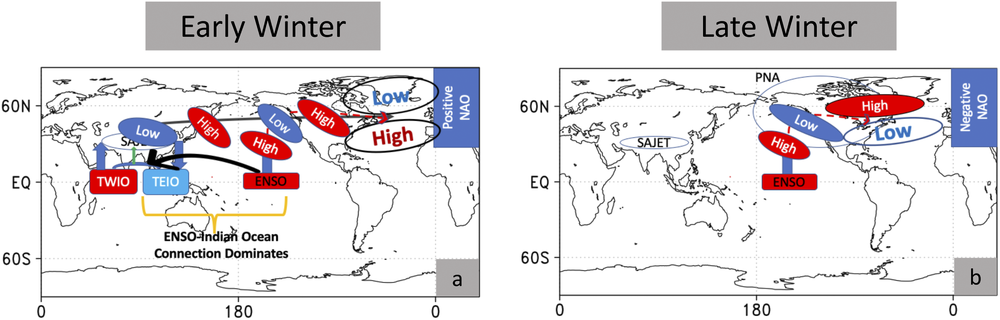
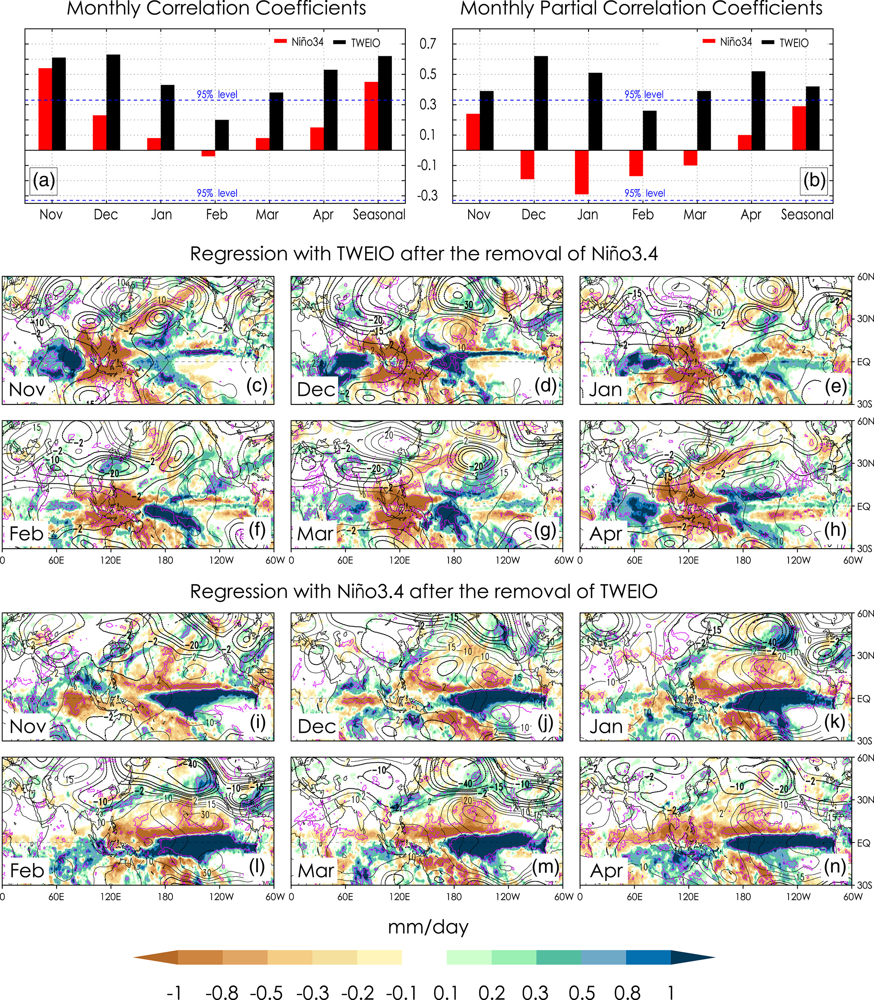

<h2>Tailoring Climate Forecasts to Action</h2>

  

    

    

      <em>
      Seamless forecast based on temporal merging.
      (a) Forecast skill (anomaly correlation) of FFD
      (black line, primary y-axis) during spring
      (March–April) for each start date over 1983–2022;
      ensemble size is shown on the secondary y-axis.
      (b) Forecast skill of the temporally merged forecast
      (blue line, primary y-axis) at each merged step,
      with corresponding ensemble size on the secondary
      y-axis. (c) Impact of equal versus relative weighting
      on merged forecast skill. (d) Comparison of forecast
      skill using randomly subsampled 15 ensemble members
      (orange line) with the full merged ensemble
      (blue line). Shading indicates the 5–95% confidence
      interval; values excluding zero indicate statistical
      significance. Note that the x-axis is nonlinear.
      </em>
    

  

  

    

      Climate forecasts are most useful when they can support
      real-world decisions. My research explores how scientists
      and industry can work together to develop climate
      information that meets the needs of decision-makers.
    

    

      In particular, I have developed an approach that combines
      ensemble forecasts across different start dates, linking
      interannual and seasonal predictions into a seamless
      forecasting framework. This approach helps provide more
      consistent climate information across timescales and
      demonstrates its potential value for supporting practical
      decisions and managing climate-related risks.
    

    

      <strong>Related publication:</strong> 
      Abid, M.A., Balan Sarojini, B. &amp; Weisheimer, A. (2026).
      <a href="https://doi.org/10.1038/s44304-026-00269-6">
      Bridging multi-annual to seasonal forecasts to develop
      seamless information for climate extremes: frost risk
      application</a>. <em>npj Natural Hazards</em>.
    

  

<h2>Role of Indian Ocean in ENSO Teleconnections to North Atlantic &amp; Europe</h2>

  

    <!-- New figure (top) -->
    

    

      <em>Caption for the new figure.</em>
    

    <!-- Existing figure (below) -->
    

    

      <em>
        Indian and Pacific Ocean contributions to the Euro-Atlantic
        circulation response to ENSO and their seasonal evolution
        from early to late winter.
      </em>
    

  

  

    

      My research investigates how tropical ocean variability,
      particularly the El Niño–Southern Oscillation (ENSO) and
      Indian Ocean conditions, influences atmospheric circulation
      and climate variability over the Euro-Atlantic region.
      I examine the relative contributions of the Indian and
      Pacific Oceans and the physical mechanisms responsible
      for the seasonal evolution of these teleconnections.
    

    

      <strong>Related publication:</strong> 
      <a href="https://doi.org/10.1175/JCLI-D-20-0075.1">
        Abid, M.A., Kucharski, F., Molteni, F., Kang, I.-S.,
        Tompkins, A.M. &amp; Almazroui, M. (2021).
        Separating the Indian and Pacific Ocean impacts on the
        Euro-Atlantic response to ENSO and its transition from
        early to late winter.
      </a>
      <em>Journal of Climate</em>.
    

  

## Role of Indian Ocean in ENSO Teleconnections to South & West Asia

*(a) Correlations between the standardized CSWA, Niño3.4, and TWEIO precipitation indices, (b) same as of (a) but with linearly independent Niño3.4 and TWEIO indices. (c–h) Regression of precipitation (shaded; mm/day) and 200-hPa geopotential height (Z200) anomalies (contours; m) onto standardized TWEIO precipitation index after removing the effect of Niño3.4; (i–n) same as in (c)–(h) but for the standardized Niño3.4 precipitation index after removing the effect of TWEIO. Purple contours represent statistical significance at 95% confidence level.*

Indian Ocean mediates ENSO teleconnections to southwest Asia. I examine the relative contributions of the Indian and Pacific Oceans and the physical mechanisms through observations & modelling experiments.

**Related publication:**

[Abid, M.A., Ashfaq, M., Kucharski, F., Evans, K.J. & Almazroui, M. (2020). Tropical Indian Ocean Mediates ENSO Influence Over Central Southwest Asia During the Wet Season. *Geophysical Research Letters*.](https://doi.org/10.1029/2020GL089308)
